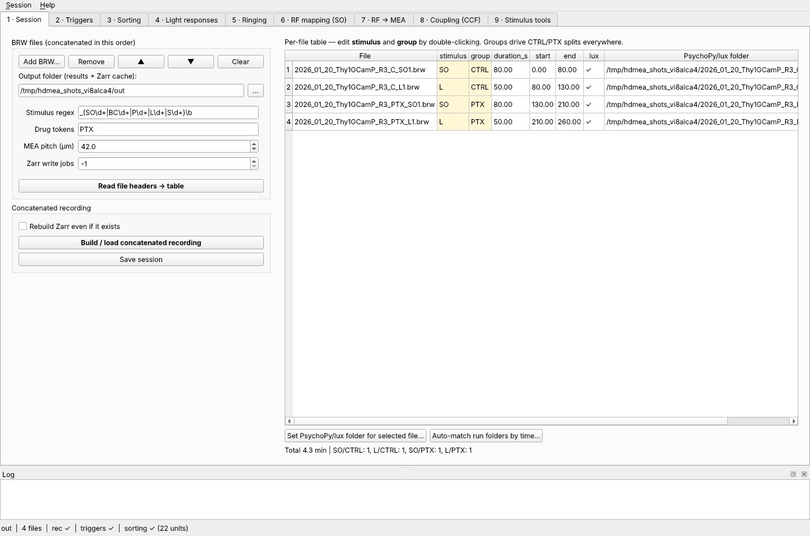
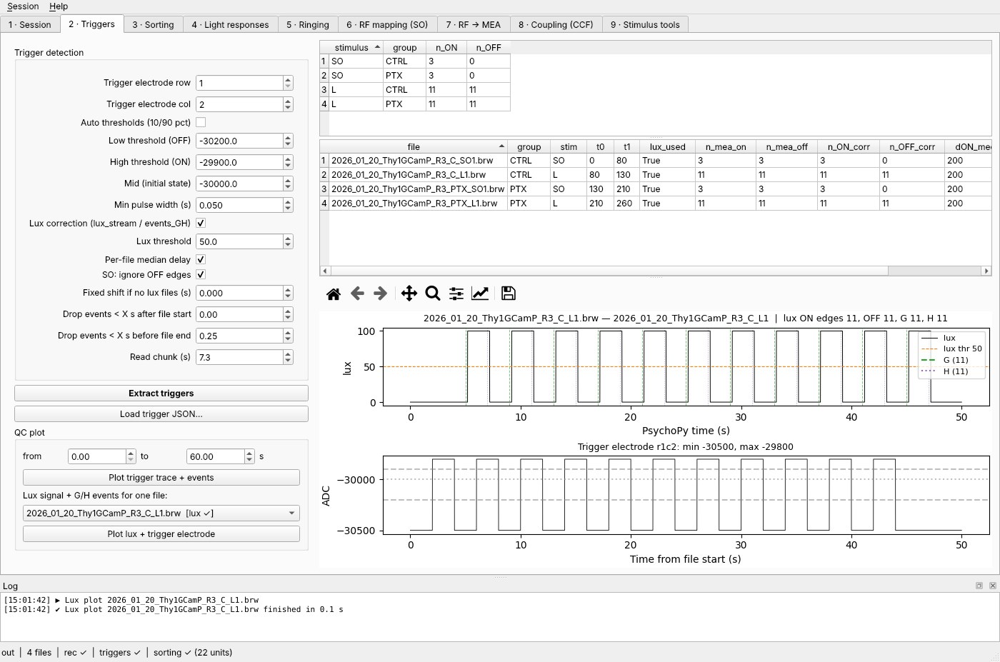
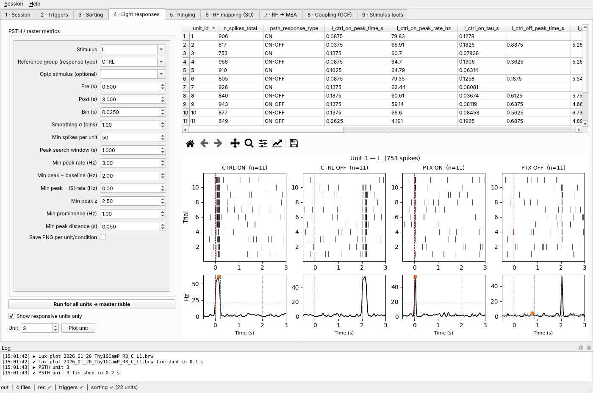
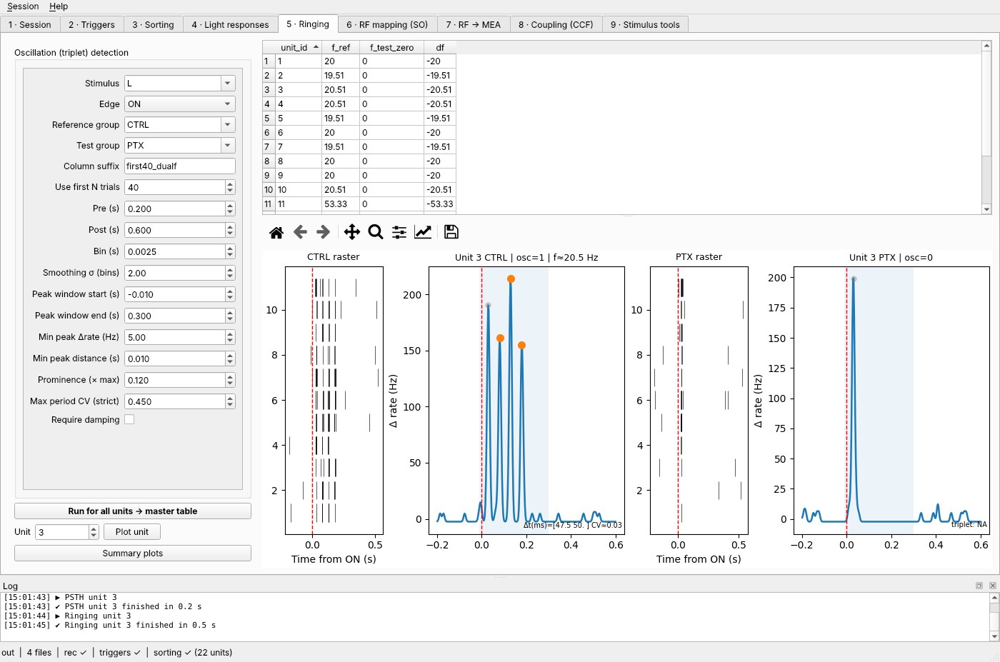
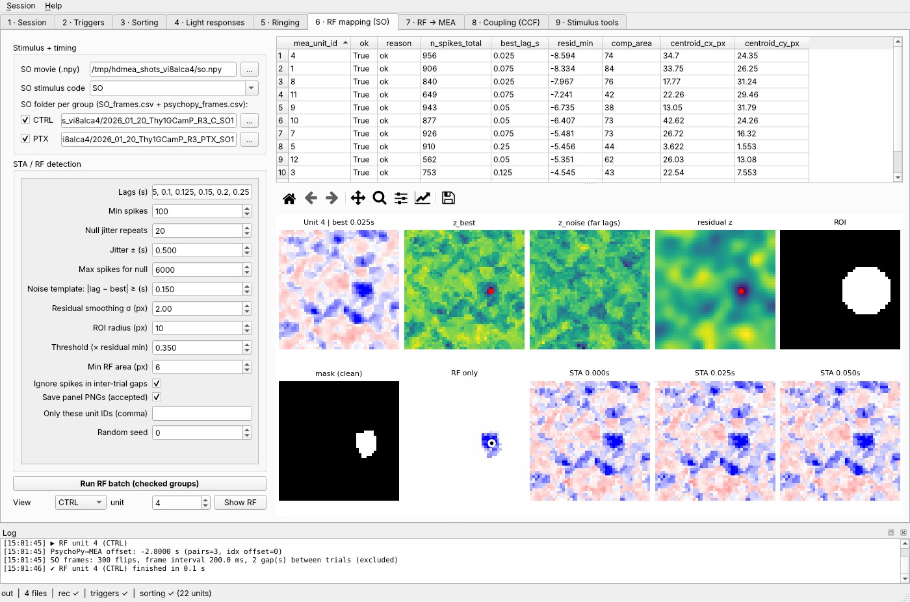
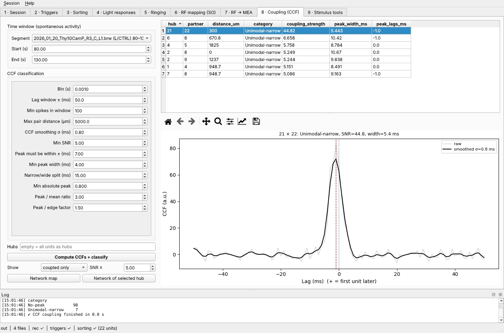

# HDMEA-Analysis

**HD-MEA Analysis** is a desktop app for BioCam (3Brain) HD-MEA recordings of the retina. It takes you from raw `.brw` files to per-unit results in one window:

- joins the BRW files of an experiment into one recording and caches it as Zarr
- finds stimulus triggers on the trigger electrode and corrects them with the lux sensor
- sorts spikes with HerdingSpikes, maps electrode activity and locates each unit on the array
- measures light responses (PSTH / raster, ON / OFF / ON-OFF, latency, τ) for CTRL vs drug (e.g. PTX)
- detects oscillatory "ringing" in the responses and compares its frequency between conditions
- maps receptive fields with sparse-object (SO) stimuli by spike-triggered average, and calibrates stimulus pixels → MEA µm
- finds electrically coupled pairs (gap junctions) from cross-correlograms
- includes stimulus tools: SO movie generator, lux-sensor TTL → light delay, camera TTL delay

Everything a step produces is saved in the experiment's output folder. That includes a master unit table (`unit_metrics_master.csv` / `.xlsx`) and a session file, so you can reopen an experiment later.

## Screenshots













## Install

Download the file for your computer from the [latest release](https://github.com/jerjely/HDMEA-Analysis/releases/latest):

| System | File | Notes |
|---|---|---|
| Windows 10 / 11 (64-bit) | `HDMEA-Analysis-<version>-Windows-setup.exe` | Installs for your user only (no admin rights). Adds a Start menu entry, and a desktop shortcut if you tick it. |
| macOS, Apple silicon (M1–M4) | `HDMEA-Analysis-<version>-macOS-AppleSilicon.pkg` | Installs **HDMEA-Analysis** into /Applications. |
| macOS, Intel | `HDMEA-Analysis-<version>-macOS-Intel.pkg` | Installs **HDMEA-Analysis** into /Applications. |

The installers are not code-signed, so your system will warn you the first time:

- **Windows:** SmartScreen says "Windows protected your PC". Click **More info → Run anyway**.
- **macOS:** the installer "cannot be opened". Open **System Settings → Privacy & Security**, scroll down, click **Open Anyway**, then open the .pkg again.

To check an installation, run the built-in self-test. It runs every pipeline step on a small synthetic dataset and opens the GUI offscreen:

```
Windows:  "%LOCALAPPDATA%\Programs\HDMEA-Analysis\HDMEA-Analysis.exe" --selftest --log selftest.log
macOS:    /Applications/HDMEA-Analysis.app/Contents/MacOS/HDMEA-Analysis --selftest --log selftest.log
```

`selftest.log` should end with `SELFTEST OK`.

### What is *not* inside the installer

**HerdingSpikes** is not bundled, because it has to be compiled with a C++ compiler. Without it, everything works except the **Run HerdingSpikes** button. You have two options:

1. Sort in an environment that already has HerdingSpikes (e.g. your SpikeInterface notebook environment), then load the `hs_full\hs_full_…` folder in **Sorting → Existing sortings**. Localisation and every later step work from there.
2. Or run the app from source in that environment (see below). The button then works directly.

## Install from source (development)

You need Python 3.10–3.12. The installers use Python 3.11.

| | Windows (conda) | macOS |
|---|---|---|
| install | double-click `install.bat`: creates the conda env `hdmea-gui` and tries HerdingSpikes separately | double-click `install.command`: creates `.venv` |
| start | double-click `start.bat` | double-click `start.command` |

To use an existing environment instead (e.g. one that already has HerdingSpikes), install the GUI packages into it:

```
conda activate <env>
pip install -r requirements.txt
python -m hdmea                # start
python -m hdmea --selftest     # self-test
```

With `start.bat`, set `ENV_NAME` to that environment's name or full path (e.g. `C:\Users\you\Anaconda\envs\spikegui`). Alternatively, put that one line in an `env_name.txt` next to `start.bat`; updates don't overwrite that file.

Developer helpers:

- `tools/make_icon.py` redraws the icon set in `hdmea/resources`.
- `tools/make_screenshots.py` regenerates `docs/screenshots`.
- `tests/` contains longer synthetic end-to-end tests.

## Making a release

Either of these starts the [Build installers](.github/workflows/build-installers.yml) workflow:

- **Tag:** in GitHub Desktop, **History → right-click the commit → Create Tag… → `v1.0.0` → Push origin** (or `git tag v1.0.0 && git push origin v1.0.0`).
- **Button:** on GitHub, open **Actions → Build installers → Run workflow** and enter `1.0.0` in the *version* box. The workflow creates the tag and release itself.

If you leave the version box empty, it only builds and tests (no release). The installers are then available as downloadable artifacts of that workflow run.

The workflow builds on `windows-latest`, `macos-15` (Apple silicon) and `macos-15-intel` (Intel). Each build:

1. writes the version from the tag into `hdmea/_version.py` (shown in the window title and in Help ▸ About)
2. runs the self-test from source
3. builds the app with PyInstaller (`HDMEA-Analysis.spec`)
4. runs the self-test with the built app
5. packages it, with Inno Setup (Windows) or `pkgbuild` (macOS)
6. installs the package on the runner and runs the self-test once more with the installed copy

Any failing self-test stops that build, and the release job only runs when all three builds succeed. The release job then attaches the three installers with the `gh` CLI and writes the release notes.

## Workflow (tabs in order)

| Tab | What it does | Comes from |
|---|---|---|
| **1 · Session** | Add the BRW files in recording order and read their headers. This gives a table of file, stimulus, group and start/end. Stimulus and group come from the file name (`_SO1`, `_L1`, … and `PTX` in the name gives the PTX group, otherwise CTRL), and you can edit both by double-clicking. **Build / load** concatenates the files, converts unsigned → signed and caches the result as `rec_concat_zarr.zarr` in the output folder. The default output folder is `<BRW folder>\<common file prefix>`, the same as in the notebook. | SO_Final cells 1–2 |
| **2 · Triggers** | Detects ON/OFF edges on the trigger electrode (row 1, col 2) with hysteresis thresholds and a minimum pulse width. If `<brw name>\lux_stream.csv` and `events_GH.csv` exist, it pairs lux ON/OFF edges with the G/H events and adds the per-file median TTL → light delay. SO OFF edges are ignored. Writes `ON_OFF_luxcorr_MEA_r1c2.json` with the same structure as before (`per_stim_group[stim][group]`). Also has a QC plot. | SO_Final cells 3–4, Biocam cell 5 |
| **3 · Sorting** | Runs HerdingSpikes on the full array after bandpass 350–6000 Hz and global CAR (defaults = your parameters), into `hs_full\hs_full_<time>`. It can also load an earlier run or any other sorter folder. Also makes an electrode activity map and localises units: the dominant HS-detected channel → MEA x/y, saved as `unit_xy_map_from_HS2_detected.csv`. | SO_Final cells 5, 6, 12 |
| **4 · Light responses** | PSTH and raster for every group × ON/OFF: peak time and rate, baseline, τ (1/e), response type (ON / OFF / ON-OFF from the reference group). Optionally, a stimulus code whose ON times are opto pulses gives PV_status. Results go to `unit_metrics_master.csv` (semicolon-separated) and `.xlsx`, plus `_PSTH_valid.csv`. Click a unit to see its rasters. | SO_Final cells 7–8 |
| **5 · Ringing** | Fine PSTH over the first N trials, candidate peaks, the best consecutive peak triplet (lowest period CV) and `f_triplet` / `osc_strict`. Columns are merged into the master table. Also gives the paired CTRL vs PTX summary (PTX = 0 Hz if the oscillation is lost). | SO_Final cells 19–21 |
| **6 · RF mapping (SO)** | Sparse-object STA per group: STA at several lags, jitter null z-map, residual against the far-lag noise template, ROI and connected component → RF mask and centroid. The SO folder for each group is filled in automatically (it is the SO BRW path without the extension and must contain `SO_frames.csv` and `psychopy_frames.csv`). Outputs go to `SO_RF_<group>\` (CSV, PNG panels, `rf_masks_npz`). Click a unit to recompute and show its panel. | SO_Final cell 10 (Untitled3 / Biocam STA cells are older versions) |
| **7 · RF → MEA** | Finds units whose RF centroid is stable between group A and B (anchors). Fits a similarity or affine transform from stimulus pixels → MEA µm, using RANSAC and a search over flips and axis swaps. Projects all RF centroids into MEA space and draws RF outlines on the MEA. Outputs go to `RF_calibration\`. | SO_Final cells 13–14, 18 |
| **8 · Coupling (CCF)** | Cross-correlograms of spontaneous activity in a chosen segment (e.g. the S file) for all unit pairs within a distance limit. Each pair is classified as No-peak / Unimodal-narrow / Unimodal-wide / Bimodal using the notebook rules. Gives a table, a pair CCF plot and a network map on the MEA. Outputs go to `CCF_coupling\`. | Biocam cells 50–56 |
| **9 · Stimulus tools** | **SO movie generator**, **lux-sensor TTL → light delay** (`so_veml_*` folders) and **camera TTL delay** (camera ROI CSV with Mean1 = screen, Mean2 = LED). | Untitled2, Untitled4 |

All settings are saved in `hdmea_session.json` in the output folder. Opening a session reloads the Zarr, the triggers and the most recent sorting.

## PsychoPy / lux folders

By default, each BRW file's PsychoPy/lux folder is the BRW path without the extension (the notebook convention). If your runs are saved somewhere else, for example `MEA stimulus\receptive field mapping\data\so_veml_YYYYMMDD_HHMMSS`, there are two ways to set them in the Session tab:
- **Auto-match run folders by time…**: each BRW gets the run folder whose timestamp is closest to the recording start, which is taken as the file's modification time minus its duration.
- **Set PsychoPy/lux folder for selected file…**: set the folder by hand.

The `lux` column shows ✓ when `lux_stream.csv` and `events_GH.csv` are found in the folder. In the Triggers tab, **Plot lux + trigger electrode** shows one file's lux trace with its G/H events, above that file's trigger electrode.

If the Zarr cache is shorter or longer than the files in the table, the app offers to rebuild it. This happens, for example, when a cache built earlier by the notebook is in the same folder.
## Changes compared with the notebooks (intentional)

- **Faster edge detection:** the trigger edge detector is vectorised. It gives the same edges as the per-sample loop but takes seconds instead of minutes on hour-long recordings.
- **RF mapping, inter-trial gaps:** spikes that fall more than 1.5 frame intervals after the last screen flip are no longer assigned to the trial's last SO frame. The notebook counted every gray-screen spike as a response to that frame, which biases the STA. You can turn this off in the RF tab ("Ignore spikes in inter-trial gaps").
- **Unit localisation, offset search:** the detection-offset search now breaks ties toward the exact match. With ±5 samples tolerance, many offsets reach 100 % hit rate, and the notebook simply took the first one.
- **Coupling CCF:** computed exactly from spike times inside the ±lag window. It matches the FFT version to within 1e-14 but runs much faster for whole-array runs. Each unit pair is evaluated once.
- **Lux delay:** duplicate PsychoPy timestamps are averaged, and the derivative threshold now has a floor. Your Jan-8 run produced a threshold of 0.000 lux/s because the MAD was zero.
- **Camera delay:** each LED edge is paired with the nearest screen edge within ±N frames. Pairing by order mismatched edges in the saved Untitled2 output and gave a mean of −1574 ms.
- **SO generator:** now seeded, so a movie can be regenerated exactly. **Do not overwrite** `so_stimulus_mouse200pix_4mm_1000frames.npy`: your existing RF maps depend on that exact file.
- **RF output folder:** RF results are written inside the experiment output folder (`SO_RF_CTRL`, `SO_RF_PTX`) instead of inside the SO PsychoPy folders.
## Notes

- **HS channel numbering:** the notebook assumed HerdingSpikes numbers channels from 1 (`ch − 1`). You can switch this to 0-based under "HS channel numbering" in the Sorting tab. The activity-map log prints which numbering gives the more spread-out map.
- **Cancel:** works between units and chunks. A Zarr write or a HerdingSpikes run that has already started cannot be interrupted.
- **Logs:** the installed app writes console output (SpikeInterface progress bars) to `~/.hdmea_analysis/app.log`.

## Licence

MIT © Gergely Szarka. See [LICENSE](LICENSE).
